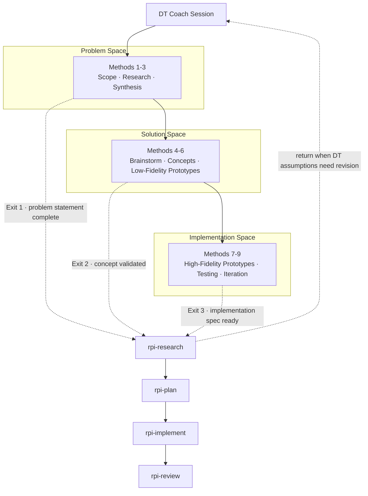

Design Thinking과 RPI는 구조화된 핸드오프 산출물을 통해 연결됩니다. DT 세션이 자연스러운 종료 지점에 도달하면, DT Coach는 검증된 발견 사항, 신뢰도 표시, 이해관계자 맵을 포함하는 산출물을 준비하며, RPI 단계 스킬은 이를 입력으로 소비합니다.

## 핸드오프 파이프라인 개요



각 종료 지점은 현재 계약 필드인 `exit_point`, `dt_method`, `dt_space`, `handoff_target`, `date`, `artifacts`, `constraints`, `assumptions`를 포함하는 핸드오프 산출물을 생성합니다. 코치는 세션 상태를 `.copilot-tracking/dt/{project-slug}/`에 유지하며, 핸드오프 산출물은 같은 디렉터리에서 프로젝트 산출물과 함께 보관됩니다.

```yaml
exit_point: "implementation-spec-ready"
dt_method: 9
dt_space: "implementation"
handoff_target: "rpi-research"
date: "2026-06-26"

artifacts:
  - path: ".copilot-tracking/dt/{project-slug}/method-09-iteration-at-scale.md"
    type: "iteration-summary"
    confidence: validated

constraints:
  - description: "The rollout must fit existing deployment windows"
    source: "stakeholder-review"
    confidence: assumed

assumptions:
  - description: "Support staff can monitor the pilot environment"
    confidence: unknown
    impact: "high"
```

## 서브에이전트 핸드오프 워크플로

DT Coach가 핸드오프 준비 상태를 감지하면, 전환을 더 신뢰성 있게 만들기 위해 평가, 컴파일, 검증 서브에이전트를 디스패치할 수 있습니다. 이 워크플로는 산출물 준비 상태를 확인하고, 핸드오프 페이로드를 현재 스키마로 컴파일하며, `rpi-research`가 소비하기 전에 생성된 RPI 엔트리 산출물을 검증합니다. Method 5b에서는 워크플로가 이미지 프롬프트를 생성하여 컨셉 산출물을 후속 리뷰를 위한 시각적 방향으로 전환하는 데 도움을 줄 수도 있습니다.

## 종료 지점

### 문제 정의 완료 (Methods 1-3 → rpi-research)

Scope Conversations, Design Research, Input Synthesis를 완료한 후, 팀은 다중 출처 증거로 뒷받침된 검증된 문제 정의를 갖게 됩니다. `rpi-research`는 이 프레이밍을 사용하여 다음을 수행합니다:

* 가정된 요구사항이 아니라 이해관계자가 검증한 니즈를 중심으로 기술 조사 범위를 설정
* `assumed` 항목을 검증 대상으로 처리
* `unknown` 항목을 주요 조사 대상으로 처리
* 핸드오프에서 식별된 각 이해관계자 관점에서 조사

### 컨셉 검증됨 (Methods 4-6 → rpi-research)

Brainstorming, User Concepts, Low-Fidelity Prototypes를 거친 후, 팀은 알려진 제약사항을 가진 이해관계자 검증 컨셉을 갖게 됩니다. `rpi-research`는 이 풍부한 산출물을 받아 다음을 수행합니다:

* 기술 조사를 통해 좁혀진 솔루션 방향을 검증
* 로우 피델리티 프로토타입 테스트에서 `assumed` 또는 `unknown`으로 표시된 제약사항을 해결
* 이해관계자 관점 전반에 걸쳐 테스트된 컨셉의 실현 가능성 평가
* 계획 수립 전에 통합 및 확장 관련 우려사항 조사

#### AI Discovery Cards 워크샵 결과 통합

AI Discovery Cards 워크샵 결과는 구현 요구사항이 아니라 Design Thinking 증거로 HVE에 들어옵니다. 유망한 워크샵 아이디어를 Method 4 아이디어 인벤토리에 추가하고, 각 아이디어를 검증된 니즈, 이해관계자, 성과, 제약사항에 연결하세요. 에이전틱 워크플로 아이디어의 경우, 트리거, 참여자, 범위가 지정된 AI 책임, 잠재적 도구와 정보, 인간의 의사결정 지점, 기대 성과, 미해결 가정을 기록하세요.

선택된 테마를 나머지 Solution Space 방법으로 전달하세요:

1. Method 5를 사용하여 선택된 테마를 User Concept로 전환하고 바람직성, 실현 가능성, 수익성을 평가합니다.
2. Method 6을 사용하여 핸드오프, 예외 경로, 인간 감독 지점을 포함한 워크플로를 프로토타입화합니다.
3. 결과 증거에 따라 주장을 `validated`, `assumed`, `unknown`, `conflicting`으로 표시합니다.
4. Solution Space 종료 시, Method 4 워크샵 노트와 아이디어 인벤토리, Method 5 컨셉, Method 6 프로토타입 결과, 제약사항, 기술적 미지수를 핸드오프 산출물에 포함합니다.
5. 핸드오프를 `rpi-research`로 라우팅합니다. `rpi-plan`이 구현 작업을 정의하기 전에, Research가 제안된 기능과 에이전틱 워크플로가 기술적으로 적절한지 판단합니다.

이 순서는 워크샵에서 얻은 영감을 HVE와 연결된 상태로 유지하면서, AI 기능 프롬프트가 검증되지 않은 아키텍처 결정이 되는 것을 방지합니다.

### 구현 스펙 준비 완료 (Methods 7-9 → rpi-research)

High-Fidelity Prototypes와 User Testing을 거친 후, 팀은 기능적으로 검증된 스펙을 갖게 됩니다. `rpi-research`는 가장 풍부한 산출물 세트를 받아 다음을 수행합니다:

* 프로덕션 준비 상태, 확장성 격차, 통합 관련 우려사항 조사
* 테스트 증거가 제한적이거나 상충되었던 항목 검증
* 프로덕션 제약사항 하에서 아키텍처 결정이 유효한지 평가
* 광범위한 DT 검증이 이미 이루어졌으므로 조사 범위를 크게 좁힘

## 단계별 입력 매핑

각 RPI 단계는 핸드오프 증거를 받을 때 DT에 특화된 조정을 적용합니다.

### rpi-research

| 표준 동작               | DT 기반 동작                                 |
|---------------------------------|------------------------------------------------------|
| 기술적 실현 가능성에 초점     | 이해관계자 영향과 기술적 실현 가능성         |
| 단일 관점 분석     | 역할과 맥락에 걸친 다중 이해관계자 분석 |
| 이진 결과 (작동함/작동하지 않음) | 품질 표시가 된 결과 (validated/assumed/unknown)  |
| 플래너로만 전달 | 타당한 경우 DT 코치로 되돌아갈 수 있음 |

조사 결과 DT 문제 정의를 수정해야 하거나, 근본적인 가정이 무효화되거나, 대표되지 않은 이해관계자가 드러나면, 연구자는 계획으로 진행하는 대신 DT 코칭으로 돌아갈 것을 권장합니다.

출처: DT 핸드오프에서 직접.

### rpi-plan

| 표준 동작               | DT 기반 동작                                        |
|---------------------------------|---------------------------------------------------------------|
| 프로덕션 품질 산출물 | 공간에 적합한 피델리티(rough/scrappy/functional)       |
| 선형 단계 실행          | 이전 방법으로 돌아가는 경로를 갖춘 반복 인식 단계 |
| 기술적 성공 기준       | 이해관계자별로 세분화된 성공 기준                      |
| 전달만 하는 검증         | DT 코치 복귀 트리거를 포함한 검증            |

계획에는 DT 코칭으로 돌아가야 하는지 평가하는 DT Reconnection 단계가 하위 구현 전에 포함됩니다.

출처: 간접적, 업스트림 `rpi-research` 출력을 통해.

### rpi-implement

| 표준 동작            | DT 기반 동작                                        |
|------------------------------|---------------------------------------------------------------|
| 프로덕션 품질 코드      | 공간에 적합한 피델리티                                  |
| 완전한 기능 전달    | DT 프로토타입 스펙과 일치하는 제약사항 검증 범위      |
| 기술적 정확성에 초점  | 정확성과 함께 이해관계자 경험 검증            |
| 완전한 다듬기 및 최적화 | 과도한 다듬기 지양: 섣부른 최적화 없는 기능적 코어 |

구현 단계는 발신 DT 공간의 피델리티 제약사항을 강제하며 변경 증거에서 DT 산출물 경로를 참조합니다.

출처: 간접적, 업스트림 `rpi-research`와 `rpi-plan` 산출물을 통해.

### rpi-review

| 표준 동작        | DT 기반 동작                              |
|--------------------------|-----------------------------------------------------|
| 코드 정확성에 초점   | 코칭 품질과 방법 충실도에 초점        |
| 합격/불합격 평가     | 공간에 적합한 피델리티 평가             |
| 스타일 가이드 준수  | Think/Speak/Empower 코칭 아이덴티티 준수 |
| 단일 출력 평가 | 다중 이해관계자 커버리지 평가           |

리뷰 단계는 식별된 모든 이해관계자 그룹이 대표되는지, 신뢰도 표시가 올바르게 적용되었는지, 출력 피델리티가 발신 공간과 일치하는지 확인합니다.

## 신뢰도 표시

모든 핸드오프 산출물은 다운스트림 에이전트가 작업을 조정하는 데 사용하는 신뢰도 표시로 내용을 태그합니다:

| 표시        | 의미                                 | 다운스트림 처리                         |
|---------------|------------------------------------------|----------------------------------------------|
| `validated`   | 다중 출처 증거로 확인됨 | 신뢰할 수 있는 입력으로 처리                      |
| `assumed`     | 사실로 추정되지만 아직 검증되지 않음      | 검증 단계 포함                   |
| `unknown`     | 조사가 필요한 정보 격차 | 주요 조사 또는 해결 대상        |
| `conflicting` | 증거가 여러 방향을 가리킴  | 다운스트림 작업 전에 반드시 해결해야 함 |

## 반복 지원

DT-to-RPI 핸드오프는 일방통행이 아닙니다. `rpi-research`가 DT 가정에서 비롯된 문제를 발견하면, DT 코칭으로 돌아갈 것을 권장합니다:

* 문제 정의를 수정해야 하거나, 대표되지 않은 이해관계자가 드러나거나, 근본적인 가정이 무효화될 때 `rpi-research`는 DT Coach로 직접 돌아갑니다.
* `rpi-plan`과 `rpi-implement`는 DT 관련 증거 격차를 `rpi-research`로 다시 라우팅하며, 이는 DT로 돌아갈 것을 권장할 수 있습니다.
* `rpi-review`는 산출물 품질 기준에 따라 DT 방법 재진입이 필요한 항목을 표시합니다.

> [!TIP]
> RPI에서 DT로 돌아가는 것은 실패의 신호가 아니라 철저함의 신호입니다. 이 통합은 두 프레임워크 전반에 걸친 비선형 반복을 위해 설계되었습니다.

## 공간 종료 절차

`dt-rpi-integration` 스킬은 공간별로 하나의 종료 절차를 정의합니다. 측면 핸드오프를 선택하면 DT Coach는 해당하는 절차를 따르며, 각 절차는 단일 RPI 진입점인 `rpi-research`를 위해 DT 산출물을 컴파일합니다:

* Problem Space 종료: `rpi-research`를 위해 Problem Space 산출물(Methods 1-3)을 패키징
* Solution Space 종료: `rpi-research`를 위해 Solution Space 산출물(Methods 4-6)을 패키징
* Implementation Space 종료: `rpi-research`를 위해 Implementation Space 산출물(Methods 7-9)을 패키징

각 절차는 관련 방법의 결과물, 신뢰도 표시, 미해결 질문을 `rpi-research`가 직접 소비하는 구조화된 핸드오프로 수집합니다. 더 늦은 단계의 종료일수록 Research 단계의 범위를 좁히는 더 풍부한 산출물을 생성합니다. 시작하려면 방금 완료한 공간에 대한 핸드오프를 준비해달라고 DT Coach에게 요청하세요.

## 관련 자료

* [튜토리얼: DT에서 RPI로 핸드오프하기](tutorial-handoff-to-rpi.md): 각 종료 지점에서의 실용적 예제를 포함한 단계별 가이드
* [Design Thinking 가이드](README.md): 9가지 방법과 3가지 공간의 개요
* [DT Coach 가이드](dt-coach.md): DT Coach 에이전트 사용법
* [RPI Workflow](../rpi/README.md): Research, Plan, Implement, Review 프레임워크

<!-- markdownlint-disable MD036 -->
*🤖 Crafted with precision by ✨Copilot following brilliant human instruction,
then carefully refined by our team of discerning human reviewers.*
<!-- markdownlint-enable MD036 -->
